# Intercom Moto

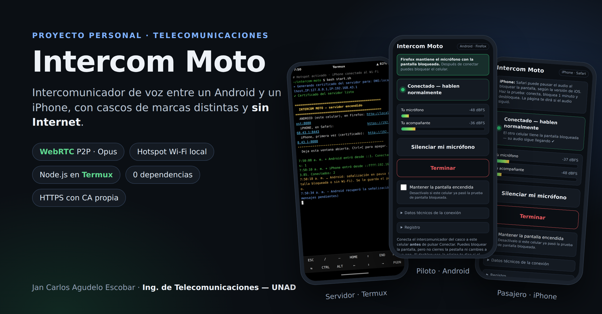

Intercomunicador de voz entre un **Android** (piloto) y un **iPhone** (pasajero) sin Internet.
El Android crea un hotspot Wi-Fi y ejecuta un pequeño servidor. Los dos celulares abren una página web, y el audio va **directo de un celular al otro** (WebRTC P2P). Cada celular manda el sonido a su intercomunicador de casco por Bluetooth, aunque sean de marcas distintas.

**Tecnologías:** WebRTC (Opus, DTLS-SRTP, ICE con candidatos host) · Node.js sin dependencias · Server-Sent Events · Termux · TLS con CA propia · Web Audio/Media Session APIs.

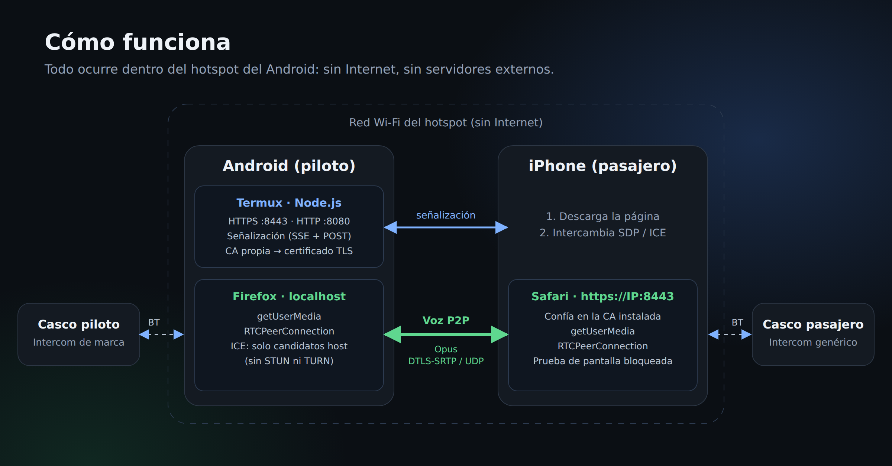

## Dos modos de funcionamiento

| | **Modo hotspot** (sin Internet) | **Modo nube** (datos móviles) |
|---|---|---|
| Servidor | El Android, con Termux | Google Apps Script |
| Acceso | Quien esté en el hotspot | Token firmado por persona |
| Página | La sirve el Android | GitHub Pages (`docs/`) |
| Guía | Esta página, más abajo | [`nube/README-NUBE.md`](nube/README-NUBE.md) |

El modo nube no depende de que un celular haga de red ni de servidor, y no requiere instalar certificados en el iPhone. A cambio, necesita señal celular en los dos teléfonos.

| Android conectado (modo nube) | Token inválido rechazado | iPhone ve al Android bloqueado |
|---|---|---|
| 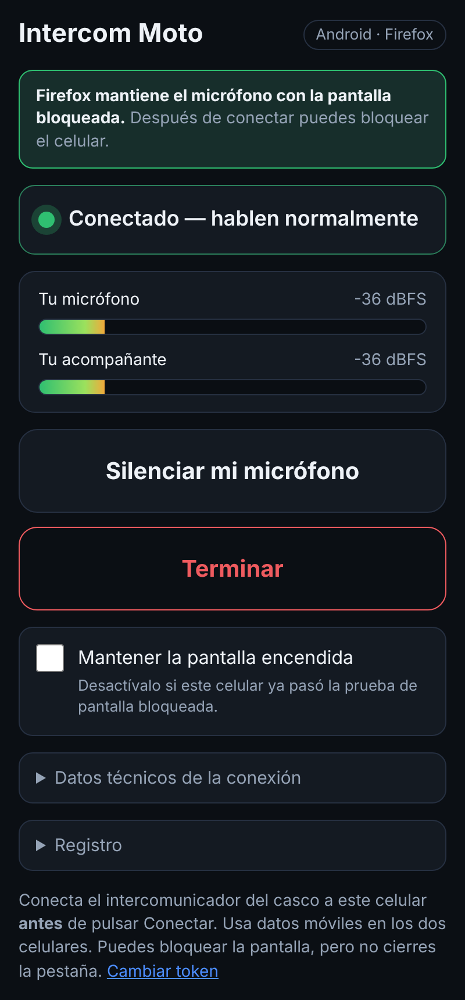 | 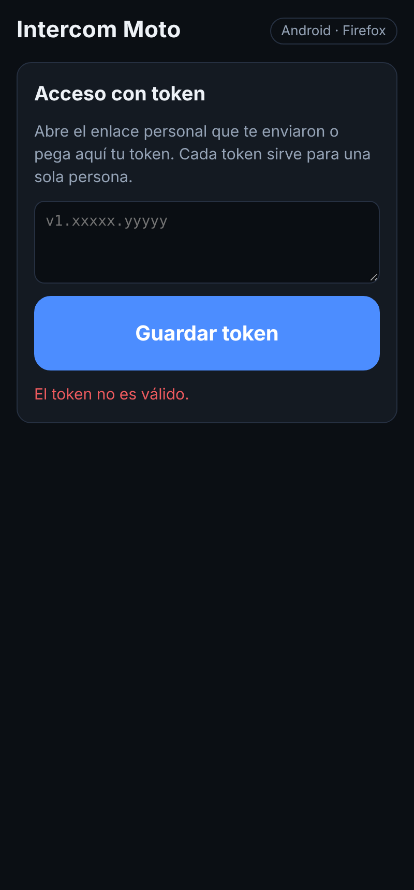 | 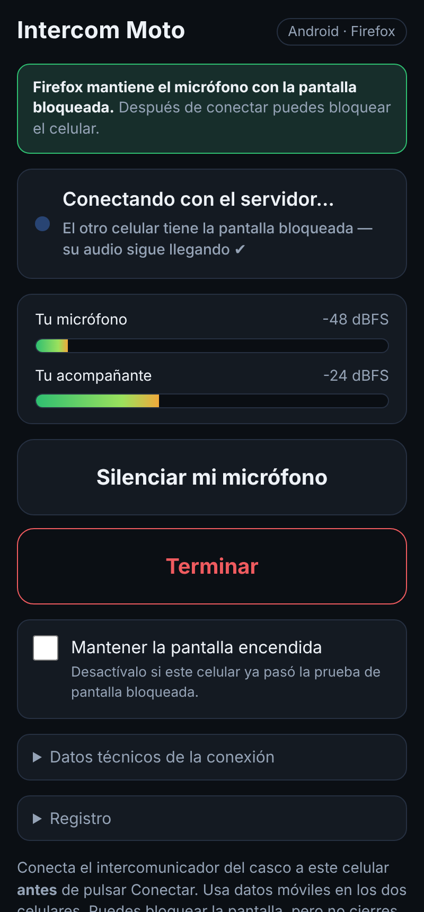 |

## Capturas

| Termux: instalación | Termux: servidor encendido | Android (Firefox) conectado |
|---|---|---|
| 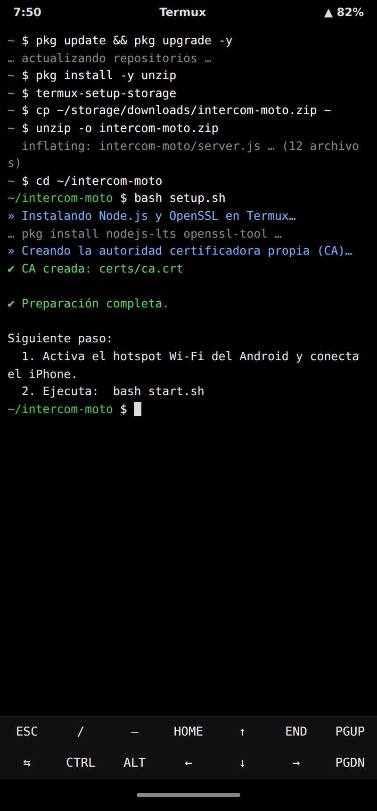 | 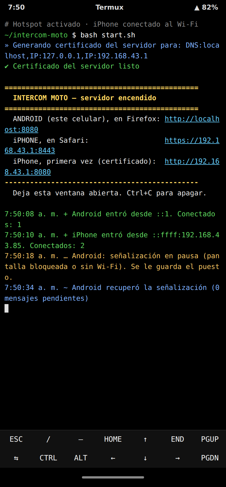 | 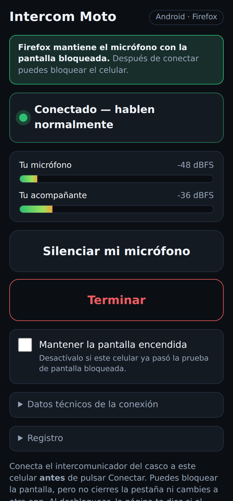 |

| iPhone: configurar certificado | iPhone: conectado + datos técnicos | Prueba de pantalla bloqueada |
|---|---|---|
| 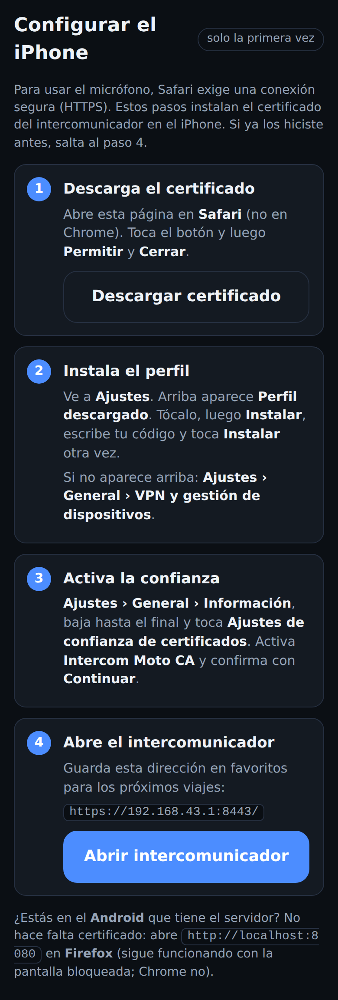 | 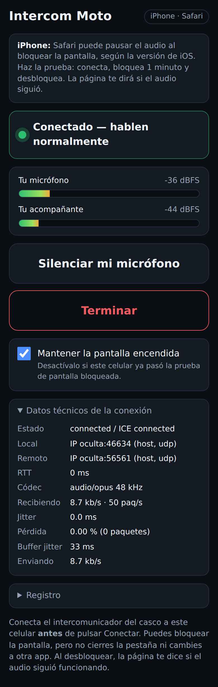 | 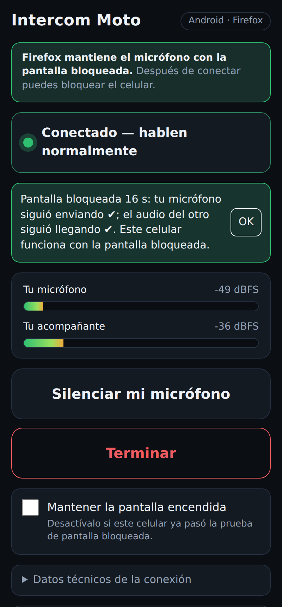 |

> Las capturas de la app se tomaron de la página real conectada entre dos navegadores. Las de Termux reproducen la salida real de `setup.sh` y `start.sh`, con la IP de hotspot de ejemplo `192.168.43.1`.

---

## Guía de instalación paso a paso

> **Pantalla bloqueada:** en el **Android usa Firefox**, no Chrome. Firefox mantiene el micrófono con la pantalla bloqueada o con otra app abierta; Chrome lo corta a los ~5 s.
> En el **iPhone**, lo que hace Safari al bloquear depende de la versión de iOS. La página **mide** si el audio siguió: bloquea, desbloquea y te lo dice. Si en tu iPhone se corta, usa el plan B de la sección [Pantalla bloqueada](#pantalla-bloqueada-qué-esperar-y-cómo-probarlo).

---

## Qué necesitas

| | Android (piloto) | iPhone (pasajero) |
|---|---|---|
| App | **Termux** (desde F-Droid o GitHub) y **Firefox** (Play Store) | **Safari** (ya viene instalado) |
| Internet | Solo la primera vez, para instalar | No |
| Intercom del casco | Emparejado por Bluetooth como manos libres | Igual |

Archivos del proyecto:

```
intercom-moto/
├── setup.sh          # preparación (una sola vez)
├── start.sh          # enciende el intercom (cada viaje)
├── server.js         # servidor local, sin dependencias
├── scripts/certs.sh  # crea los certificados HTTPS
└── public/           # la página: index.html, app.js, style.css, setup.html
```

---

## PARTE 1 — Preparación en casa (una sola vez, con Internet)

### Paso 1. Instalar Termux en el Android
1. Instala **Termux** desde **F-Droid** (f-droid.org) o desde la página de *releases* de `termux/termux-app` en GitHub.
   Es la vía que recomienda el propio proyecto. La versión de Play Store tiene limitaciones.
2. Abre Termux y escribe (Enter después de cada línea):
   ```bash
   pkg update && pkg upgrade -y
   pkg install -y unzip
   termux-setup-storage
   ```
   `termux-setup-storage` te pide permiso para acceder a los archivos. Acéptalo.

### Paso 2. Copiar el proyecto al Android
1. Descarga `intercom-moto.zip` en el Android. Queda en la carpeta **Descargas**.
2. En Termux:
   ```bash
   cp ~/storage/downloads/intercom-moto.zip ~
   cd ~ && unzip -o intercom-moto.zip
   cd ~/intercom-moto
   ```

### Paso 3. Instalar y crear certificados
```bash
bash setup.sh
```
Esto instala **Node.js** y **OpenSSL** y crea tu propia autoridad certificadora (`certs/ca.crt`). El iPhone la necesita para permitir el micrófono.
Solo se ejecuta **una vez**. No borres la carpeta `certs/`, o tendrás que repetir la configuración del iPhone.

### Paso 4. Evitar que Android cierre Termux
- **Ajustes › Aplicaciones › Termux › Batería** → *Sin restricciones* (o "No optimizar").
- Haz lo mismo con **Firefox**. Es clave para que siga funcionando con la pantalla bloqueada.
- En Samsung, revisa también **Cuidado del dispositivo › Batería › Límites de uso en segundo plano**, y saca Termux de "aplicaciones en suspensión".

### Paso 5. Configurar el hotspot del Android
1. **Ajustes › Conexiones / Red › Zona Wi-Fi portátil (Hotspot)**: ponle nombre y contraseña.
2. Desactiva **"Apagar automáticamente si no hay dispositivos conectados"** si tu teléfono tiene esa opción.
3. Actívalo. **No necesita datos móviles**: funciona igual sin SIM o sin saldo.

### Paso 6. Configurar el iPhone (solo la primera vez)
1. En el iPhone, conéctate al Wi-Fi del hotspot del Android. Aparecerá "Sin conexión a Internet". Es normal.
2. En el Android (Termux):
   ```bash
   cd ~/intercom-moto
   bash start.sh
   ```
   La pantalla muestra algo así:
   ```
   ANDROID (este celular), en Firefox: http://localhost:8080
   iPHONE, en Safari:                  https://192.168.43.1:8443
   iPhone, primera vez (certificado):  http://192.168.43.1:8080
   ```
3. En el iPhone abre **Safari** con la dirección **http://…:8080** que muestra Termux. Aparece la página **"Configurar el iPhone"**. Sigue sus 4 pasos:
   1. **Descargar certificado** → *Permitir* → *Cerrar*.
   2. **Ajustes** → *Perfil descargado* (arriba) → **Instalar** → código → **Instalar**.
   3. **Ajustes › General › Información › Ajustes de confianza de certificados** → activa **Intercom Moto CA** → *Continuar*.
   4. Toca **Abrir intercomunicador** y **guarda esa dirección en Favoritos**.

> ¿Termux no muestra la IP del iPhone? Mírala en el iPhone: **Ajustes › Wi-Fi › (i)** junto a la red del hotspot › **Router**. Luego inicia con esa IP:
> `bash start.sh 192.168.X.X`

### Paso 7. Prueba en casa
Haz la **PARTE 2** completa en casa, con los cascos puestos, antes del viaje.

---

## PARTE 2 — Uso en cada viaje

1. **Empareja cada intercomunicador con su celular** (Bluetooth). Hazlo *antes* de abrir la página.
2. **Android:** activa el **hotspot**.
3. **iPhone:** conéctate al Wi-Fi del hotspot.
4. **Android — Termux:**
   ```bash
   cd ~/intercom-moto && bash start.sh
   ```
   Deja Termux abierto en segundo plano. No lo cierres.
5. **Android — Firefox:** abre `http://localhost:8080` → **Conectar** → *Permitir micrófono* (marca "Recordar").
6. **iPhone — Safari:** abre el favorito `https://IP:8443` → **Conectar** → *Permitir micrófono*.
7. Cuando el estado muestre **"Conectado — hablen normalmente"**, ya pueden hablar en ambos sentidos, sin botones.
8. **Bloquea las pantallas** solo en los celulares que pasaron la prueba de bloqueo (ver abajo). Los demás, en un soporte con la pantalla encendida y conectados al cargador.

Botones de la página:
- **Silenciar mi micrófono**: corta tu micrófono. El botón se pone rojo mientras está activo.
- **Terminar**: cuelga. Para volver a hablar, toca **Conectar** otra vez.
- **Mantener la pantalla encendida**: impide que la pantalla se apague sola. Viene activado en iPhone y Chrome, y desactivado en Firefox Android. Bloquear con el botón de encendido siempre es posible.
- **Datos técnicos**: muestran la ruta ICE (candidatos host/udp), el RTT, el jitter, la pérdida de paquetes, el códec Opus y el bitrate.

Para apagar el servidor: en Termux, **Ctrl + C** (en el teclado de Termux: `CTRL` y luego `c`).

---

## Pantalla bloqueada: qué esperar y cómo probarlo

| Navegador | Con la pantalla bloqueada o con otra app encima |
|---|---|
| **Firefox (Android)** | Sigue enviando y recibiendo audio. Está diseñado así: pausa la cámara, pero mantiene el micrófono. **Usa este.** |
| Chrome (Android) | Deja de enviar tu voz a los ~5 s (bug de Chromium 374374232, abierto). Sigues oyendo al otro. |
| Safari (iPhone) | Depende de la versión de iOS: hay reportes de que pausa WebRTC al bloquear y otros de que sigue enviando audio. Hay que probarlo. |

**Prueba de bloqueo (hazla en casa, en cada celular):**
1. Conecten los dos celulares y hablen para comprobar que se oyen.
2. Bloquea la pantalla de uno de ellos durante **1 minuto** y sigan hablando.
3. El otro celular muestra en vivo, debajo del estado:
   - *"El otro celular tiene la pantalla bloqueada — su audio sigue llegando ✔"*, o
   - *"…su navegador pausó el audio"*.
4. Desbloquea. La página muestra el resultado medido con los contadores RTP:
   - Verde: *"tu micrófono siguió enviando ✔; el audio del otro siguió llegando ✔"*. Ese celular funciona bloqueado; puedes desactivar **Mantener la pantalla encendida**.
   - Amarillo: *"tu micrófono se detuvo ✖"*. Ese celular debe ir con la pantalla encendida.

**Plan B para el iPhone si no pasa la prueba — Acceso guiado.** Deja la pantalla encendida pero ignora los toques, así puede ir en el bolsillo sin tocar nada por accidente:
1. **Ajustes › Accesibilidad › Acceso guiado** → actívalo y pon un código.
2. En esa misma pantalla, **Bloqueo automático de pantalla** → *Nunca*.
3. En Safari, ya conectado: **triple clic en el botón lateral** → **Opciones** → desactiva **Tocar** → **Iniciar**.
4. Para salir: triple clic → código → **Finalizar**.

Baja el brillo al mínimo y lleva el iPhone conectado a una batería externa.

---

## Consejos en ruta

- **iPhone:** en **Ajustes › Wi-Fi**, desactiva *Unirse automáticamente* en otras redes conocidas. Así no abandona el hotspot.
- Brillo al mínimo y cargador USB en la moto. Con la pantalla encendida, lo que más batería gasta es la pantalla, no el audio.
- **Android con Firefox:** puedes abrir el GPS u otra app; el micrófono sigue. **No cierres la pestaña** ni deslices Firefox fuera de "Recientes".
- Si reciben una llamada telefónica, el sistema pausa el micrófono. Al colgar, la conexión se recupera sola.
- Si se alejan de la moto (parada), el Wi-Fi se pierde. Al volver, la conexión se recupera sola en unos segundos.

---

## Solución de problemas

| Síntoma | Solución |
|---|---|
| El iPhone muestra "Configurar el iPhone" en vez del intercom | Entraste por `http://…:8080`. Usa `https://…:8443`. |
| Safari dice "Esta conexión no es privada" | Falta el paso 6.3 (confianza del certificado), o la IP cambió. Ejecuta `bash start.sh` otra vez: el certificado se regenera con la IP nueva y la confianza del iPhone se mantiene. |
| "Página no segura: el micrófono está bloqueado" | En Android usa **exactamente** `http://localhost:8080`, no la IP. En iPhone, usa `https://`. |
| Aviso amarillo "Chrome corta el micrófono…" | Estás en Chrome. Abre la misma dirección en Firefox. |
| Con Firefox se corta al bloquear | Revisa que Firefox tenga batería *Sin restricciones* (Paso 4) y que no uses ahorro de energía extremo. |
| Queda en "Esperando al otro celular…" | El otro celular no ha tocado **Conectar**, o el iPhone no está en el Wi-Fi del hotspot. |
| "Ya hay dos celulares conectados" | Una sesión anterior quedó abierta. Espera unos 20 s: se libera sola. También puedes reiniciar el servidor. |
| El sonido sale por el altavoz del celular y no por el casco | Conecta el intercom por Bluetooth **antes** de tocar Conectar. Si ya estaba conectado: *Terminar*, desconecta y reconecta el Bluetooth, y *Conectar*. |
| `EADDRINUSE` al iniciar | Ya hay un servidor encendido. Cierra la otra sesión de Termux o reinicia Termux. |
| Termux se cierra solo | Revisa el Paso 4 (batería). `start.sh` ya activa `termux-wake-lock`. |
| Se corta cada vez que el piloto mira el GPS | Estás usando Chrome: cambia a Firefox. |

Para ver qué pasa: en la página abre **Registro**. En Termux verás quién entra y sale.

---

## Cómo funciona (para el ingeniero)

1. **Contexto seguro.** `getUserMedia` solo existe en páginas HTTPS o en `localhost`.
   - El Android abre `http://localhost:8080`, que ya es seguro.
   - El iPhone usa `https://IP:8443` con un certificado firmado por tu CA propia (`scripts/certs.sh`). El certificado del servidor incluye la IP en el *SubjectAltName* y dura 397 días. Se regenera automáticamente si cambia la IP del hotspot.
2. **Señalización.** `server.js` no usa dependencias externas.
   - Los celulares reciben mensajes por **Server-Sent Events** (`/events`) y envían por `POST /signal`.
   - El servidor solo reenvía la oferta y la respuesta SDP y los candidatos ICE. La sala admite 2 participantes.
   - Si solo se cae la señalización, el audio P2P sigue. El cliente vuelve con la misma sesión y no se renegocia.
3. **Medio.** `RTCPeerConnection({ iceServers: [] })`: no usa STUN ni TURN.
   - Como el micrófono se pide antes de crear la oferta, los navegadores publican candidatos *host* con la IP real, en lugar de alias `.local` de mDNS.
   - Audio Opus mono a 32 kb/s como máximo, con prioridad alta. Cancelación de eco, supresión de ruido y control automático de ganancia activados.
4. **Segundo plano.**
   - La página declara `navigator.audioSession.type = 'play-and-record'` (Safari) y una *Media Session* activa, y mantiene el `<audio>` remoto reproduciendo.
   - Si el sistema pausa la reproducción, la reanuda.
   - Al bloquearse, avisa al otro celular (`peerHidden`). El otro mide si siguen llegando paquetes RTP: Opus sin DTX envía unos 50 paquetes/s aunque haya silencio.
   - Al desbloquear, compara los contadores `packetsSent`/`packetsReceived` de antes y después y muestra si el audio fluyó.
   - El servidor **no expulsa** a un celular cuyo navegador cerró la señalización por el bloqueo. Le guarda el puesto 10 min y encola los mensajes (ofertas, candidatos) para entregárselos al volver.
5. **Robustez.**
   - Reinicio de ICE si la conexión pasa a *disconnected* o *failed*.
   - Si el sistema libera el micrófono, se vuelve a pedir y se cambia en caliente con `replaceTrack`.
   - Wake Lock de pantalla, que se vuelve a pedir al regresar a la página.
   - Aviso visual cuando la página estuvo en segundo plano.

Puertos: `8080` (HTTP: localhost y descarga del certificado) y `8443` (HTTPS). Se pueden cambiar con `HTTP_PORT` y `HTTPS_PORT`. Si cambias `8443`, actualiza también `public/setup.html`.

## Seguridad

- `certs/ca.key` es la llave de tu autoridad certificadora. El iPhone confía en ella, así que **no la compartas** ni copies la carpeta `certs/` a otros lugares.
- Si pierdes el Android, o ya no usas el intercom, borra el perfil del iPhone: **Ajustes › General › VPN y gestión de dispositivos › Intercom Moto CA › Eliminar perfil**.
- Todo el tráfico queda dentro del hotspot. El audio va cifrado de extremo a extremo con DTLS-SRTP.
